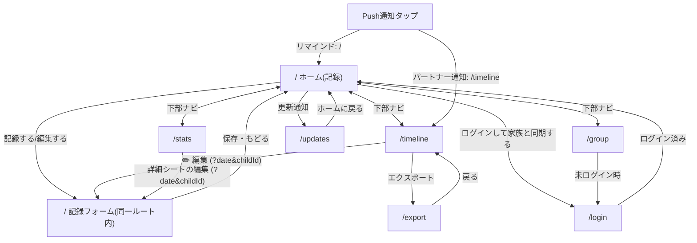
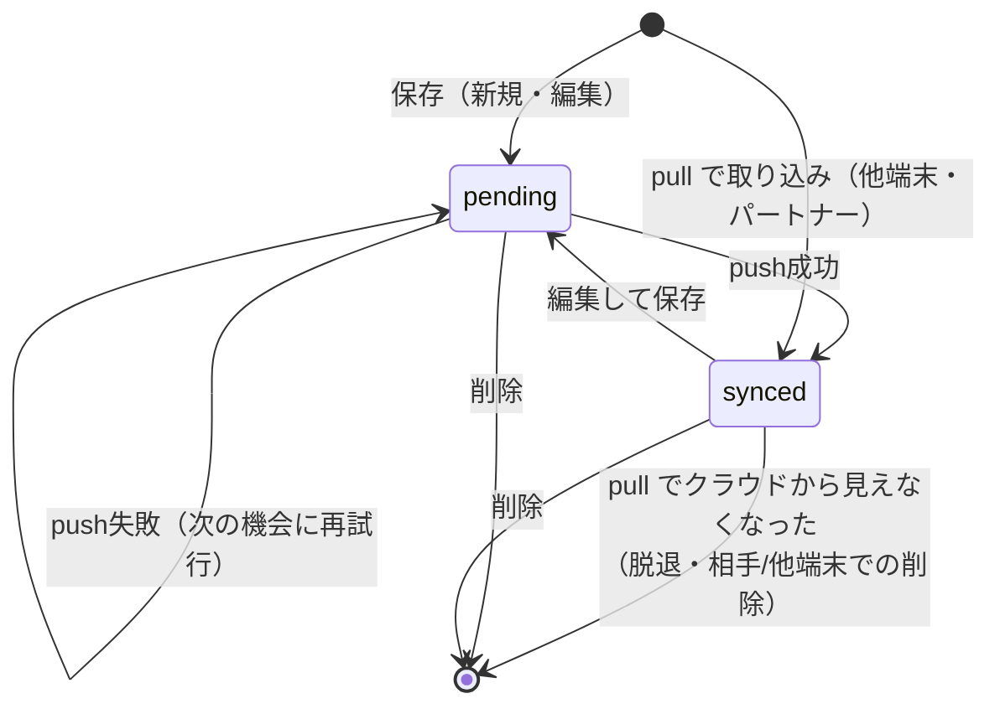

# あさノート 仕様書

子どもが登校を渋る朝のようすを、選ぶだけでサッと記録する家族向けPWA。
本書は実装（`src/`・`supabase/`・`public/sw.js`・`e2e/`・`.github/workflows/`）から起こした現状の仕様書で、**食い違いがあれば実装が正**。
対象バージョン: v0.4.2（`src/data/releases.ts` 先頭）。

## 本書の使い方・メンテナンス方針

- 実装箇所は `path/to/file.ts` で示す（行番号は書かない）。
- コードから意図が確証できない点は **要確認 Qn** と明記し、付録A に一覧する。解消したら本文へ反映して付録から消す。
- 「〜のため（推定）」は、コードやコメントに根拠が無く、書き手が理由を補った箇所。

### 更新ルール

CIが強制するもの（`.github/workflows/ci.yml` の `release-notes-check`、判定は `scripts/check-release-notes.mjs`）:

| 条件 | 結果 |
|---|---|
| `src/app/` `src/components/` `src/lib/` `src/constants/` `public/` に、テスト（`*.test.ts(x)`）・生成型（`database.types.ts`）以外の変更がある | `src/data/releases.ts` の更新が必須。先頭 version が変更前より新しくなければ失敗 |
| `releases.ts` 先頭・`package.json`・`package-lock.json` の version が不一致 | 常に失敗（例外指定でも確認される） |
| PRに `no-release-note` ラベル、またはPR本文・タイトル・コミットメッセージに `[skip release-note]` | 更新履歴の追加チェックのみ省略（依存更新・内部リファクタ等） |

CIが強制しないもの（レビューで担保する）:

- **本書の更新はCIの対象外**。挙動・スキーマ・運用手順を変えるPRは、同じPRで本書も更新する。ユーザー向けの変更なら `releases.ts` と version（`package.json` / `package-lock.json`）も同じPRで更新する。
- `docs/`・`README.md`・`supabase/`・`scripts/`・`e2e/` のみの変更は `release-notes-check` の対象外（更新履歴は不要）。
- `supabase/schema.sql` を変えたら `npm run db:types` で `src/lib/db/database.types.ts` を再生成する（`db-types-check` が差分を検出して失敗させる）。`main` マージ時に本番へ自動適用される（§8）。
- Push通知まわりのSQL・Edge Functionは自動適用されない（§8、`docs/push-notifications-setup.md`）。

## 1. プロダクト概要

### 1.1 何を解決するか

子どもの登校渋りは、朝のごく短い時間に起き、親は振り返る余裕がない。後から「いつ・どんな朝に渋ったか」を思い出せず、学校や専門家に状況を説明しづらい。
あさノートは、その朝のようすを**選ぶだけ**で記録し、積み重ねから傾向（良かった理由・気になる理由）を見返せるようにする。

### 1.2 対象ユーザー

| 区分 | 内容 |
|---|---|
| 主な利用者 | 登校渋りの子どもを持つ保護者。夫婦・家族で1つのグループを作って共有する想定（README「家族向け」） |
| 間接的な受け手 | 学校の先生・スクールカウンセラー等。エクスポート（印刷/PDF/CSV）を受け取る（`src/app/export/page.tsx` の説明文） |
| 利用形態 | スマートフォンのホーム画面に追加したPWA（縦向き。`public/manifest.webmanifest`）。ブラウザでも使える |

利用範囲（家族内の限定運用か、一般公開か）はコードから確証が取れない。**要確認 Q13**

### 1.3 設計原則

| 原則 | 具体化 | 主な実装 |
|---|---|---|
| 入力の手間を最小化する | 結果・起床・出発・理由はタップで選ぶ。時刻は3区分。記録は1画面で完結。メモは任意 | `src/app/_home/` |
| オフラインファースト | 保存はまず端末のIndexedDBへ。通信が無くても記録自体は失敗しない。未ログインでも使える | `src/lib/db/records.ts` `localDb.ts` |
| 入力を失わない | 入力途中は下書きとして自動保存し、他画面へ行っても復元する | `src/app/_home/draftStorage.ts` |
| 責めず、どちらも見返す | 「いい日も気になる日も、どちらも振り返れる」（傾向画面の文言）。理由は前向き/気になるの両方を持つ | `src/app/stats/page.tsx` |
| 家族で共有し、誤操作で壊さない | グループ内で記録を共有するが、編集・削除は記録者本人のみ | `src/lib/db/ownership.ts`・RLS（§6） |
| 個人情報を必要最小限にする | エクスポートにメールアドレスを出さない。計測は内容（メモ・タグ文言）を送らない | §6.5, §11 |

### 1.4 ユーザーストーリー

| ID | ストーリー | 章 |
|---|---|---|
| U1 | 保護者として、忙しい朝でも数タップで結果を残したい | §3.1 |
| U2 | 保護者として、夜や後日に、朝の記録を追加・修正したい（過去日も選べる） | §3.1 |
| U3 | 保護者として、電波が悪くても記録が消えないでほしい | §7 |
| U4 | 保護者として、パートナーがもう記録したか、すぐ知りたい | §3.1, §4 |
| U5 | 保護者として、未記録の日は夜に思い出させてほしい | §4 |
| U6 | 保護者として、曜日・起床時刻・理由ごとの傾向を見て対策を考えたい | §3.3 |
| U7 | 保護者として、一定期間の記録を学校やカウンセラーへ渡したい | §3.4 |
| U8 | 保護者として、夫婦で同じ記録を見たい。ただし相手の記録を誤って消したくない | §3.5, §6 |
| U9 | 複数の子どもがいる保護者として、子どもごとに記録・集計を分けたい | §3.1, §3.5 |
| U10 | ログインが面倒な人として、まず登録なしで試したい | §3.6 |

## 2. 画面一覧と遷移

### 2.1 ルート一覧

| ルート | 画面 | 目的 | 主な操作 | 主な遷移先 |
|---|---|---|---|---|
| `/` | ホーム（記録） | 日付を選び、その日の結果・理由等を記録する | 日付選択、子ども切替、記録開始/編集、保存 | `/updates`（更新通知）、`/login`（ヘッダー） |
| `/timeline` | これまでの記録 | 自分＋パートナーの記録を新しい順に見る | 子ども・結果での絞り込み、編集、削除 | `/?date=…`（編集）、`/export` |
| `/stats` | 傾向 | 内訳・カレンダー・曜日別/起床時刻別スムーズ率・理由を見る | 子ども切替、各項目タップで詳細シート | `/?date=…`（詳細シートから編集） |
| `/export` | エクスポート | 期間を指定して日記形式で印刷/PDF、またはCSV出力する | 期間・パートナー含有の指定、印刷、CSV | `/timeline` |
| `/group` | 共有 | 子ども・通知・グループの設定 | 子どもの追加/改名/削除、通知設定、グループ作成/参加/脱退、招待 | `/login`（未ログイン時） |
| `/login` | ログイン | メールのマジックリンクでログインする | メール入力→送信 | ログイン済みなら `/` へ置換 |
| `/updates` | 更新履歴 | 全バージョンの更新内容を見る（開くと最新版を既読にする） | 閲覧 | `/` |
| （404） | `not-found.tsx` | 存在しないURL | — | `/` |
| （エラー） | `error.tsx` / `global-error.tsx` | 想定外エラーのフォールバック。「やり直す」で再描画（Next 16 の prop 名は `retry`） | やり直す | — |

共通要素:

- **下部ナビ**（`src/components/BottomNav.tsx`）: 記録する(`/`)・これまで(`/timeline`)・傾向(`/stats`)・共有(`/group`)の4タブ。現在地は完全一致で判定するため、`/export` `/login` `/updates` ではどのタブも選択状態にならない。入力途中の下書きがあると「記録する」にドットのバッジを出す。印刷時は非表示。
- **同期失敗の通知**（`SyncFailureNotice`）: 同期が連続失敗したときだけ画面下部に出す（§7.6）。
- **ログイン状態表示**（`AuthStatus`）: ホーム画面のヘッダーにのみ表示される（ログインへのリンク／メールアドレス・未同期件数・ログアウト）。他の画面にはログアウト導線が無い。
- **読み込み中**（`loading.tsx`）: ルート遷移中のスケルトン。

### 2.2 遷移図

`/` 内の「ホーム」と「記録フォーム」は同一ルートの2状態（`Step = "home" | "form"`、`src/app/_home/types.ts`）。フォームへ進むと `history.pushState` で履歴を1つ積み、ブラウザ/端末の戻るボタンで home へ戻れる（`useStepNavigation.ts`）。

## 3. 機能仕様

### 3.1 記録する（ホーム `/`）

#### 3.1.1 ホーム状態（日付を選ぶ）

上から順に表示する（`src/app/page.tsx`）:

1. ヘッダー: 「{M月D日(曜)}のきろく」とログイン状態表示。
2. 更新通知（§3.7）。
3. パートナーの完了バッジ: グループに2人以上いて、**今日**の、**選択中の子ども**（子ども1人以下なら未分類）のパートナーの記録に結果が入っていれば「💐 今日の記録は完了しています」を出す（`PartnerRecordStatus`）。未完了のときは何も出さない。
4. 子ども切替: 子どもが2人以上のときだけ表示（「すべて」は無い。記録は必ず特定の子に紐づくため）。
5. 月カレンダー（`MonthCalendar`）。
6. アプリ内リマインド（§4.1）。
7. 記録ボタン、または記録済みの要約カード。

月カレンダー:

- ◀▶で月を移動できる（選択日は変わらない）。表示月が今月でなければ「今日」ボタンで今日へ戻る。
- 日付セルをタップすると選択（accent色で塗りつぶし）。**未来日も選べて記録できる**（制限なし。意図は **要確認 Q19**）。
- 記録のある日は結果ごとの淡色とドットで示す（スムーズ=accent / 行き渋り=amber / 行かなかった=calm）。パートナーの記録も含め、同じ日に複数あれば更新が新しい方を使う。子どもは選択中の子に一致する記録のみ（`useRecordStatusForMonth`）。
- 日曜と祝日は赤、土曜は青で日付・曜日見出しを表示する（選択中のセルは塗りつぶし色を優先し、色分けしない）。祝日は `@holiday-jp/holiday_jp` の同梱データで判定する（通信不要。`src/lib/holidays.ts`）。祝日名はセルの `title` / `aria-label` に入る。

記録ボタン（選択日に**自分の**記録があり結果が入っていれば要約カード、無ければ開始ボタン）:

- 開始ボタン: 「📝 今日の様子を記録する」（過去日・未来日は「この日の様子を記録する」）。
- 要約カード: 結果の絵文字とラベル、理由（「・」区切り、1行に切り詰め）、「✏️ 記録を編集する」。パートナーの記録はここには出ない（カレンダーの色と完了バッジにのみ反映）。
- ボタン上で左右にスワイプ（50px以上かつ横方向優位）すると日付が前後に動く。左→翌日、右→前日。スワイプ直後の合成クリックでボタンが誤作動しないよう一度だけ抑止する。
- 読み込み中（その日の記録をIndexedDBから取得するまで）はスケルトンを出す。

#### 3.1.2 フォーム状態（入力する）

「記録する」「編集する」で同一ルート内のフォームへ進む。1画面で最後まで入力できる（画面遷移なし）。ヘッダーの「← もどる」（ブラウザの戻る、端末の戻るも同じ）でホームへ戻る。**戻ると入力途中の内容は下書きごと破棄される**（§3.1.4）。

| 順 | 項目 | 入力 | 必須 | 保存先（`records`） |
|---|---|---|---|---|
| 1 | 今日はどうだった？（過去日は「この日は」） | 3択: 😊 スムーズ / 😣 行き渋った / 🏠 行かなかった。選択中はリング＋✓ | **必須** | `outcome`（`smooth` / `reluctant` / `absent`） |
| 2 | ⏰ 朝起きた時間は？ | 3区分から1つ: 7時より前 / 7時〜7時15分 / 7時15分〜。もう一度押すと解除 | 任意 | `wake_time`（代表値 `06:59` / `07:08` / `07:15`） |
| 3 | 🕗 出発した時刻は？ | 3区分から1つ: 8時より前 / 8時過ぎ / 8時半以降。もう一度押すと解除 | 任意 | `depart_time`（代表値 `07:59` / `08:15` / `08:30`） |
| 4 | 😊 よかった理由は？ / 😣 気になる理由は？ | タグを複数選択、「＋追加」で自由入力のタグを追加。**結果を選ぶまで表示しない** | 任意 | `reason_tags` |
| 5 | 📝 メモ欄 | 自由記述（最大2000文字。残り文字数表示） | 任意 | `memo` |
| 6 | 記録プレビュー | 入力から自動生成した日記文（表示のみ） | — | 保存しない |

- 区分の定義は `src/lib/wakeTime.ts` / `src/lib/departTime.ts`。保存は代表値、表示は時刻から区分へ引き直す。旧データや他端末の任意の時刻も同じ境界で区分に寄る。
- 理由の候補: 結果が「スムーズ」なら前向きな理由、それ以外なら気になる理由（初期セットは `src/constants/choices.ts`）。**自分の過去の記録（その子どもの分）での使用回数が多い順**に並べ、同数は初期セットの定義順。「＋追加」のタグは、そのタグを使った記録が残る限り翌日以降も候補に出る（使った記録が無くなれば消える）。初期セットは使用0回でも常に出す（`src/lib/reasonOptions.ts`）。
- 結果を「スムーズ」と「それ以外」の間で切り替えると、選択済みの理由はクリアされる（候補が別の集合のため）。「行き渋った」↔「行かなかった」の切替では保持する。
- 日記文は「{結果ラベル}。理由は「A・B」。{出発区分}に出発。{メモ}。」の形（`src/lib/recordPreview.ts`）。起床時刻は含まない。エクスポートでも同じ関数を使う。
- 保存ボタン「✓ この日の記録を保存する」は、結果が未選択、または読み込み中は無効。無効の間は「「今日はどうだった？」を選ぶと保存できます」と案内する。

#### 3.1.3 保存

1. メモを2000文字に切り詰め、IndexedDBへ即時書き込み（`syncStatus: "pending"`）。同じIDなら上書きで、`createdAt` は初回の値を保つ。
2. バックグラウンドでSupabaseへの同期を試みる（§7）。
3. 「💐 保存しました」を約1.8秒表示し、ホームへ戻る（下書きはホーム到達時に消える）。

保存時、旧フォーム由来のフィールド（起床タグ・きっかけ・対応タグ・同行者・引き渡し先）と体調（`conditionScale`）は、既存記録が持っていればそのまま書き戻す（消さない）。新規記録では空/nullになる。

#### 3.1.4 下書き

- フォーム状態の間、入力内容を `localStorage`（キー `asa-note:draft`）へ保存し続ける。1枠のみ。ホーム状態になる（保存・戻る・下部ナビのリセット）と削除する。
- 再訪時、**下書きの日付と選択日が一致する場合のみ**、IndexedDBの内容より優先して復元し、フォーム状態へ直接進む（履歴も1つ積む）。
- 入力途中の記録があると、下部ナビ「記録する」にバッジを出す（別タブでの変更も購読する）。
- フォーム状態で下部ナビの「記録する」を押すとホーム状態へ戻る（既にホームルートにいるため、`window` イベントで伝える。`src/lib/recordFlowReset.ts`）。
- 旧版（フローが3画面だった頃）の下書きは、ホーム以外のステップをすべてフォームとして読み込む。

#### 3.1.5 他画面からの編集リンク

`/?date=YYYY-MM-DD[&childId=…]` で開くと、その日付（と子ども）を選択し、**常にフォーム状態**で開く（既存記録があれば内容を読み込む。無ければ空フォーム）。`childId` は端末の「選択中の子ども」にも反映する。タイムライン・傾向の詳細シートの編集導線がこれを使う。

#### 3.1.6 業務ルール

| ルール | 理由 |
|---|---|
| 記録は「記録者×日付×子ども」で1件。同じ日に再度記録すると既存を編集する（`findLatestOwnRecordForDate`）。**一意制約はアプリ側のみ**（DBに無い。§5.4, §7.5） | 朝の記録を1件で完結させ、見返す単位を日にそろえる（推定） |
| 結果が必須。理由欄は結果の後に出す | 結果によって理由の候補が変わるため（`RecordFormView` のコメント） |
| 起床・出発は3区分 | 朝の忙しい時間に分単位の入力を求めない。分単位の精度は振り返りに使っていないため |
| 理由は使用頻度順 | よく使う理由をすぐ選べるように（v0.3.0） |
| メモは2000文字まで | DBの `CHECK` 制約と同じ値。超えると同期が永久に失敗するため（#57） |
| 子どもが0〜1人の家庭では記録を常に「未分類」（`childId: null`）で保存する | 入力を増やさないため（`resolveEffectiveChildId`） |
| 保存はローカル先行 | オフラインでも記録を必ず成功させるため |
| 下書きを残す | 他の画面を見に行っても入力途中を失わないため |
| 自分の記録だけが要約・編集の対象 | パートナーの記録を誤って上書きしないため（§6） |

#### 3.1.7 エラー時の挙動

- 同期の失敗は保存を妨げない。連続失敗時のみ通知する（§7.6）。
- 子ども一覧の取得に失敗（オフライン含む）すると「子どもなし」と同じ扱いになり、記録は `childId: null` で保存される。**要確認 Q8**
- IndexedDBへの書き込み失敗を扱う専用のUIは無い（`handleSave` に `try/catch` が無い）。
- ブラウザの `localStorage` が使えない環境（プライベートブラウズ等）では、下書き・選択中の子ども等の保存を黙ってあきらめ、入力自体は続けられる（`src/lib/localStorageStore.ts`）。

### 3.2 これまでの記録（`/timeline`）

- **表示**: 自分とパートナーの記録を、日付の新しい順（同日は更新が新しい順）に一覧表示する。1件のカード:
  - 日付（M/D(曜)）、結果バッジ（正式名称。例「スムーズに行けた」）。パートナーの記録にはメールアドレス頭文字のアバター（`title` にメールアドレス。グループ内のみ）。
  - メモ。
  - チップ: 保存された起床時刻（例「06:59起床」。区分名ではなく代表値が出る。**要確認 Q1**）、旧フォーム由来の「〇〇に引き渡し」「〇〇登校」、全タグ（起床・きっかけ・理由・対応の各タグを連結）。**出発時刻は表示しない**。
- **絞り込み**:
  - 子ども: 2人以上のときのみ「すべて」＋各子ども。常に「すべて」から始め、端末の「選択中の子ども」とは独立（子ども追加直後に既存の未分類記録が見えなくなるのを防ぐ）。子どもを選ぶと、その子に紐づく記録だけを出す（未分類は「すべて」のときのみ見える）。カードに子ども名は出ない（**要確認 Q14**）。
  - 結果: すべて / 😊 スムーズ / 😣 行き渋り / 🏠 休み（単一選択。常に「すべて」から）。
- **操作**: 自分の記録だけに ✏️（フォームへ遷移。`/?date=…&childId=…`）と 🗑（確認ダイアログ「この記録を削除しますか？この操作は取り消せません。」経由で削除）を出す。2つのアイコンは誤タップを避けるため間隔を空ける。
  - 認証の読み込み中は所有者が確定しないため、どの記録にも編集・削除を出さない（`canEditRecord`。パートナーの記録を誤って消すとローカルから失われるため）。表示系（アバター等）は読み込み中を「自分の記録」と楽観的に扱う（`isOwnRecord`）。
  - 削除はまずローカルから消して削除キューへ積み、同期でサーバーへ反映する（§5.4）。
- **空表示**: 記録が1件も無い→「まだ記録がありません…」。絞り込みで0件→「この条件に一致する記録がありません。」
- 旧フォーム（〜v1）の記録は、旧フィールド（起床タグ・引き渡し先等）を含めて後方互換で表示する。
- 「📄 エクスポート」リンクで `/export` へ。

### 3.3 傾向（`/stats`）

パートナーの記録を含めて集計する。子ども2人以上なら切替（「すべて」始まり。選択中の子に一致する記録のみ）。

| 区画 | 内容 |
|---|---|
| これまでの内訳 | 「全N件」（結果未入力を含む件数）。結果入りの記録だけで、3結果の積み上げバーと件数・割合。各結果をタップで詳細シート。結果入りが0件なら案内文のみ |
| カレンダー | 読み取り専用の月カレンダー（日付はタップ不可）。表示月が今月でなければ「今月」ボタン。凡例は3結果の色 |
| 曜日別のスムーズ率 | 日→土の順。結果入りの記録だけを数え、記録が無い曜日は行ごと省く。「スムーズ率(%)」と件数を併記（少数件の割合を読み違えないため） |
| 起床時刻とスムーズ率 | 記録画面と同じ3区分（`WAKE_SLOTS`）で集計。起床時刻が未入力・不正な記録は対象外。旧データの任意の時刻も同じ境界で区分に寄る |
| よかった日によく見られる理由 | 結果が「スムーズ」の記録の理由タグを件数順に上位6件。バー幅は「全N件」に対する割合（最小6%） |
| 気になる日によく見られる理由 | 「行き渋った」「行かなかった」の記録の理由タグを同様に上位6件 |

各項目（内訳・曜日・起床区分・理由タグ）をタップすると**詳細シート**（モーダル。`StatsDetailSheet`）を開く:

- 3つの統計値: 「記録日数」（実際は該当記録の件数）、最も多い曜日（同数1位は先に見つかったもの）、月平均件数（記録のある月ごとの平均。小数第1位）。
- 期間別推移: 日別 / 週別（日曜始まり） / 月別に切替。件数が0の期間は行を作らない（疎な記録で横に間延びさせないため）。
- 過去の記録: 該当する記録を新しい順に一覧。自分の記録は「編集する →」でフォームへ、パートナーの記録はアバター付きで閲覧のみ。
- 背景タップまたは ✕ で閉じる。

集計は純関数（`src/app/stats/aggregate.ts` / `detail.ts`）に切り出してテストで固定している（件数や曜日のずれは画面がエラーにならず静かに誤るため）。

### 3.4 エクスポート（`/export`）

学校の先生・スクールカウンセラー等への共有を想定した、期間指定の出力。**サーバーへは何も送信せず**、ブラウザの印刷（「PDFとして保存」）またはCSVダウンロードで完結する。

- **入力**: 開始日（既定: 今日の30日前）・終了日（既定: 今日。今日より後は選べない。開始日≦終了日）。パートナーが居る場合のみ「パートナーの記録も含める」（既定ON）。
- **対象**: 期間内で、**結果が入っている**記録のみ（入力途中の記録は除く）。日付の昇順（同日は更新順）。子どもでの区別・絞り込みは無い。
- **印刷/PDF**: 各記録を「{日付}」＋日記文（§3.1.2 のプレビューと同じ関数）で並べる。パートナーの記録は「(パートナーの記録)」の表示のみで、**メールアドレス等は出さない**。印刷時は操作UIと下部ナビを隠し、「登校の記録({期間})」の見出しを出す。
- **ファイル名**: 「印刷する」を押した瞬間に `document.title` を `asanote_YYYYMMDD-YYYYMMDD`（単日は `asanote_YYYYMMDD`）系の名前へ**同期的に**差し替えて `window.print()` を呼び、保存名の候補に反映する（`afterprint` で元へ戻す）。`useEffect` で差し替える方式は、Next.js の Metadata API が再レンダリングのたびに書き戻して効かないため採らない。現行の `buildExportFilename` は `.csv` 拡張子付きの名前を返すため、印刷時のタイトルにも `.csv` が付く。**要確認 Q2**
- **CSV**: 同じ期間・絞り込みで出力。列は 日付・曜日・結果（正式名称）・起床時刻（保存値の `HH:MM`。区分名ではない。**要確認 Q1**）・出発時刻（区分名）・タグ（各タグ群を「、」で連結）・メモ・記録者（「自分」/「パートナー」）。UTF-8 BOM付き（Excelの文字化け防止）、CRLF、RFC4180相当のエスケープ。パートナーの記録も「パートナー」とだけ出し、メールアドレスは含めない。
- 対象が0件のときは印刷・CSVボタンを無効にし、「この期間の記録がありません。」を出す。

### 3.5 共有（グループ・子ども・通知 `/group`）

未ログインのときは「記録を共有するにはログインが必要です」とログインへの導線のみ。ログイン中は上から「お子さま」「通知」「グループ」の3区画を出す。

#### お子さま

- 追加（名前1〜50文字、前後空白は除く）・名前の変更・削除（確認ダイアログ「〇〇さんを削除しますか？これまでの記録は残りますが、お子さまの割り当ては外れます。」）。
- 2人以上登録すると、記録・タイムライン・傾向に子ども切替が出る。0〜1人の間は「子ども」の概念をUIに出さない（`childId` は常に null）。
- 子どもを削除しても記録は残る。`records.child_id` が `on delete set null` のため、割り当てだけが外れて「未分類」に戻る（記録を巻き込んで消さない）。
- 子どもの一覧は**オンライン時にSupabaseへ直接読み書き**し、IndexedDBへはミラーしない（家族単位の設定情報で、記録のようにオフラインで作る必要が薄いため。`src/lib/db/children.ts`）。
- 編集・削除できるのは作成者のみ（RLS）。画面は同じグループのメンバーが作成した子どもにも操作ボタンを出すが、実行するとエラー表示になる。

#### 通知

ON/OFFと時刻の設定。仕様は §4。

#### グループ

- 1ユーザーは同時に1グループのみ所属できる（`group_members.user_id` が `unique`）。夫婦・家族単位の想定。スキーマはN人のメンバーを許容するが、3人以上での運用はコードからは確認できない（§13）。
- **未所属**: 「グループを作る」「招待コードを持っている→参加する」の2択。
  - 作成すると、グループ作成と作成者の追加を `create_group()` でアトミックに行い、続けて**招待コードを自動発行**する（発行に失敗してもグループは作られ、手動発行を案内する）。
  - 参加は、招待コード（前後空白除去・大文字化。入力は16文字まで）を `redeem_group_invite()` で照合・消費する。無効・期限切れは「招待コードが無効か、期限切れです」、既に所属は「既にグループに所属しています」。参加後はグループ情報と子ども一覧を取り直し、記録を `pull` する（パートナーの記録が即座に見えるように）。
- **所属中**: メンバー一覧（メールアドレス。自分に「あなた」）、招待コード、「グループを抜ける」。
  - 招待コード: 8文字（紛らわしい `0/O/1/I/L` を除いた32種）、**発行から24時間で失効・1回限り**。手入力・音声共有を想定した字種。表示は期限内・未使用の最新1件。「新しく発行する」で追加発行できるが、**既存の期限内コードは無効化されない**。「共有する」は `navigator.share` があれば共有シート、無ければクリップボードへコピー（失敗時は「画面のコードを手動で控えてください」と案内）。
  - 脱退: 確認ダイアログ（「実行後は相手の記録がすぐに見えなくなります。この操作は取り消せません。」）の後、自分の `group_members` 行のみ削除する。相手のグループ所属には影響しない。脱退後に `pull` し、見えなくなった記録をローカルから消す。
- 共有の効果: 同じグループのメンバーの記録・子どもが互いに閲覧できる。**編集・削除は記録した本人のみ**（§6）。
- 通信エラー時は画面上部に赤いエラー文（通信エラーは共通文言、それ以外は「〇〇に失敗しました(詳細)」）を出す。

### 3.6 ログイン・ログアウト

- **ログイン（`/login`）**: パスワード不要。メールアドレスを入れると、Supabase Auth がマジックリンクを送る。リンクを開くとログインされる（コードの手入力UIは無い）。
  - 再送のクールダウンは30秒。最後に送信した時刻を `localStorage` に持つため、再読み込みしても有効。**メールアドレス別ではなく端末単位**で、別のアドレスへ送り直す操作もクールダウン中は不可。
  - 通信エラーは共通の通信エラー文言、それ以外はSupabaseのメッセージを表示。
  - ログイン済みで開くと `/` へ置き換える。
  - 事前設定（Supabase の Site URL / Redirect URLs）は §8。
- **未ログインの利用**: この端末内での記録・閲覧はできる。ログインすると同期が有効になり、家族と共有できる。**未ログイン時に作った記録は、後にログインしたアカウントへ同期される**（`userId` 未設定の記録は自分のものとして扱い、同期時にログイン中のユーザーIDを付与する）。
- **ログイン直後**: `pull`（クラウドの記録を取り込む）と、未送信の記録の `push`。
- **ログアウト**（ホームのヘッダー）:
  1. まず最終の同期を1回試す。
  2. それでもクラウドへ未反映の変更（未送信の記録・未反映の削除）が残っていれば、件数を示す確認ダイアログを出し、「消してログアウト」を選ばない限り何もしない（「やめる」で中止）。
  3. サインアウトし、**この端末のIndexedDB（Dexie）を全消去**する。サインアウトに失敗しても消去は行う。共有端末で前ユーザーのデータが次のユーザーのアカウントへ誤同期されるのを防ぐため。
  - 消去されるのはIndexedDBのみ。`localStorage` の下書き・選択中の子ども等は残る。**要確認 Q16**
  - Push購読は解除しない。**要確認 Q5**

### 3.7 更新履歴（`/updates`・更新通知）

- データは `src/data/releases.ts`（新しい順。先頭が最新版で、`currentVersion` の元）。各版は version・日付・タイトル・要約・詳細（箇条書き）を持つ。
- ホーム状態の先頭に、最新版の1行通知（`ReleaseNotice`）を出す。最後に確認した版（`localStorage` の `asa-note:lastSeenReleaseVersion`）が最新と異なれば「🆕 {M/D}に更新しました」、同じなら「📋 更新履歴」。タップで `/updates`。
- `/updates` を開くと最新版を既読にする。全版をカードで一覧表示する。
- 更新履歴は、ユーザー向けの変更ごとにPRで追記する（§本書冒頭の更新ルール）。

## 4. 通知

記録の抜けを減らすため、**アプリ内リマインド**と**Web Push**の2系統を持つ。Pushにはさらに「未入力日のリマインド」と「パートナーのきろく追加」の2種類がある。

| 系統 | 届く条件 | 時刻の基準 | アプリを閉じていると |
|---|---|---|---|
| アプリ内リマインド（§4.1） | 12時以降にホームを開き、今日の自分の記録が未入力 | 端末のローカル時刻 | 出ない |
| Push: 未入力日のリマインド（§4.3） | 設定した時刻に今日の記録が未入力 | JST固定 | 届く |
| Push: パートナーのきろく追加（§4.4） | パートナーが結果入りの記録を新規に作った | 即時（作成が同期された時点） | 届く |

### 4.1 アプリ内リマインド

ホーム状態のカレンダー下に、インラインの帯「🔔 今日の記録がまだのようです」を出す（`src/components/RecordReminderNotice.tsx`）。

表示条件（すべて満たすとき）:

1. **今日の自分の記録**に結果が入っていない。子どもごとの内訳は見ず、その日に誰かの子ども分でも1件でも記録済みなら出さない。読み込みが終わるまでは出さない。
2. 端末のローカル時刻が**12時以降**。朝の記録前に催促しないため（`REMINDER_HOUR`）。
3. 今日まだ「閉じる」を押していない。押すと日付を `localStorage`（`asa-note:reminderDismissedDate`）に覚え、その日のうちは再表示しない。翌日は自動で再び対象になる。

操作: 「記録する」→ 選択日を今日に切り替えてフォームへ。「閉じる」→ 当日分を非表示。固定表示のトーストではなく通常のブロックとして流し込み、ヘッダーや記録ボタンと重ならないようにしている。

### 4.2 通知設定（`/group` の「通知」）

- ブラウザが Service Worker・Push API・Notification に対応していなければ「お使いのブラウザはプッシュ通知に対応していません。」のみ表示する（`src/lib/push.ts` の `isPushSupported`）。
- 項目: 「未入力日のリマインド通知」スイッチ、「パートナーがきろくを追加したとき」スイッチ、「通知時刻」（既定21:00。変更は即保存）。
- どちらかのスイッチをONにすると、この端末にまだPush購読が無ければブラウザの通知許可を求め、購読を作成して `push_subscriptions` へ登録（同じ `endpoint` なら上書き）し、続けて設定を `notification_settings` へ保存する。次の場合はエラー文を出して保存しない: 公開鍵 `NEXT_PUBLIC_VAPID_PUBLIC_KEY` 未設定、許可が得られない、購読の保存に失敗。
- OFFにしても購読は残し、フラグだけ倒す（送信側がフラグを見てスキップするため）。
- 既定値: 設定行が無い間、画面はリマインドOFF・パートナー通知OFF・21:00を表示する。設定行は最初の保存で作られる。DBの列既定は `enabled = true` だが、行が無ければ送信対象にならない（`fetchNotificationSettings`）。パートナー通知の列既定はOFF（許可を求める操作を伴うため、本人が明示的にONにするまで送らない）。

### 4.3 Push: 未入力日のリマインド

Supabase Edge Function `send-reminders`（`supabase/functions/send-reminders/index.ts`）を、`pg_cron` が**毎分**呼ぶ（`supabase/cron-reminders.sql`）。

1. 現在のJST時刻（HH:MM）が `reminder_time` と一致し `enabled = true` のユーザーを探す（分単位の完全一致）。
2. そのうち、今日（JST）に結果入りの記録が1件も無いユーザーだけを対象にする（子どもは区別しない。`selectReminderTargets`）。
3. 対象ユーザーの**全購読**へ送る。内容: タイトル「あさノート」、本文「今日の記録がまだのようです」、遷移先 `/`。
4. 送信が 410 / 404（購読の失効）なら、その購読行を削除する。それ以外の失敗は警告ログのみで購読は残す。

分単位の一致のため、該当の1分間に実行が失敗・欠落するとその日は届かない（再送しない）。

### 4.4 Push: パートナーのきろく追加

条件と流れ:

1. `records` のトリガー（`supabase/partner-notify-trigger.sql`）が、**結果入りの記録が新規にできた時だけ**発火する: INSERT で `outcome` が入っている、または UPDATE で `outcome` が null から値になった。結果が既にある記録の編集や、同期の再送（upsert）では発火しない。オフラインで作った記録は、同期でサーバーに入った時点で発火する。
2. トリガーが Edge Function `notify-partner` を service role で呼ぶ（`{ user_id, record_id }`）。Authorization が service role と一致しなければ 401。クライアントからは呼ばない。
3. 記録者と同じグループの、本人以外のメンバーのうち `notify_partner_record = true` の人の全購読へ送る。**判定に使うのは受信者側の設定のみ**（記録者の設定は無関係）。子どもは区別しない。
4. 内容: 「〇〇さんがきろくを追加しました」（〇〇は記録者のメールアドレスの `@` より前。表示名を持たないため。取れなければ「パートナーがきろくを追加しました」）。遷移先 `/timeline`。
5. 410 / 404 の購読は削除。通知の失敗（`pg_net` 側の問題等）で記録の保存を巻き戻さない（トリガー内で例外を握る）。

### 4.5 通知の受信（Service Worker）

`public/sw.js` の `push` イベントで通知を表示し（アイコン `/icons/icon-192.png`。ペイロードが読めなければ既定文言）、`notificationclick` で、開いているウィンドウがあればそこへ遷移してフォーカス、無ければ新しく開く。

### 4.6 デプロイと運用

`push_subscriptions` / `notification_settings` テーブルは `schema.sql` の自動適用に含まれる。**Edge Functionのデプロイ、VAPID鍵の発行とシークレット設定、`pg_cron` の登録、パートナー通知のトリガー作成は自動化の対象外**で、`docs/push-notifications-setup.md` の手順で手動実施する（§8）。iOSでは、ホーム画面に追加したPWAとして開いている必要がある（同ドキュメント）。

`send-reminders` には、`notify-partner` のような Authorization 検証が無い。**要確認 Q6**

## 5. データモデル

### 5.1 記録（`SchoolRecord` / `records`）

クライアントは Dexie（IndexedDB）にサーバーと同じ形の記録をミラーする。TypeScript の型は `src/types/models.ts` の `SchoolRecord`、ローカルは `LocalRecord = SchoolRecord & { syncStatus }`（`src/lib/db/localDb.ts`）。サーバーの列との変換は `src/lib/db/sync.ts` の `toRecordRow` / `fromRecordRow`。

| クライアント | `records` 列 | 型・制約 | 説明 |
|---|---|---|---|
| `id` | `id` | uuid, PK | クライアントでUUID生成。ローカルとクラウドで同一IDを使い、同期を冪等にする |
| `recordDate` | `record_date` | date, not null | 記録対象日（`YYYY-MM-DD`） |
| `outcome` | `outcome` | text, null可 | `smooth` / `reluctant` / `absent`。DBは制約なしのtextで、3値への制限はアプリ側。未入力・旧形式は null |
| `wakeTime` | `wake_time` | time, null可 | 起床時刻。入力は3区分の代表値（§3.1.2）。サーバーは `HH:MM:SS` で返すため、pull時に先頭5文字へ正規化して `HH:MM` に揃える（`normalizeTimeValue`） |
| `departTime` | `depart_time` | time, null可 | 出発時刻。同上 |
| `reasonTags` | `reason_tags` | text[], not null | 現行フォームの理由タグ |
| `memo` | `memo` | text, null可, **`CHECK` 2000文字以内** | 自由記述（`MEMO_MAX_LENGTH` と同値） |
| `userId` | `user_id` | uuid, not null, FK `auth.users`（削除で連鎖） | 記録者。未同期のうちはクライアント側で未設定（＝自分の記録として扱う） |
| `childId` | `child_id` | uuid, null可, FK `children`（`on delete set null`） | 対象の子ども。子どもが0〜1人の家庭では常に null |
| `createdAt` / `updatedAt` | `created_at` / `updated_at` | timestamptz | **クライアントが設定する**（DBの既定値 `now()` は使われない）。`updatedAt` は同日複数件のときの選択と表示順に使う |
| `conditionScale` | `condition_scale` | smallint, null可, `CHECK` 1〜5 | 体調（5段階）。型・保存・同期は残るが入力UIは無く、新しい記録では常に null（過去の入力値は保持）。**要確認 Q4** |
| `wakeTags` / `triggerTags` / `responseTags` | `wake_tags` / `trigger_tags` / `response_tags` | text[], not null | 旧フォーム（〜v1）のタグ。入力不可、表示・エクスポートのためだけに保持 |
| `companion` / `handoff` | `companion` / `handoff` | text, null可 | 旧フォームの同行者・引き渡し先。同上 |
| `syncStatus` | （サーバーに無い） | `"pending"` \| `"synced"` | ローカル専用。§5.4 |
| （対応なし） | `struggled` | boolean, null可 | 旧フォームの「登校を渋ったか」。**アプリは読み書きしない**（`schema.sql` と生成型にのみ現れる）。削除は #46 で扱う方針（時期は **要確認 Q20**） |

索引: `idx_records_user_id`、`idx_records_record_date`。**`(user_id, record_date, child_id)` の一意制約は無い**（§7.5）。

### 5.2 その他のテーブル

| テーブル | 主な列・制約 | 用途 |
|---|---|---|
| `groups` | `id`, `name`(未使用), `created_by`, `created_at` | 記録を共有する単位 |
| `group_members` | PK(`group_id`,`user_id`)、**`user_id` unique**（1ユーザー1グループ）、`joined_at`。索引 `group_id` | 所属。対応するTS型は無い（メンバー表示は `GroupMemberProfile`） |
| `group_invites` | `code` unique、`expires_at`（既定=作成+24時間）、`used_at` / `used_by`（1回限り）。索引 `group_id` | 招待コード（§6.4） |
| `children` | `id`, `created_by`(FK、削除で連鎖), `name` 1〜50文字(`CHECK`), `created_at`。索引 `created_by` | 子ども。グループ内で共有 |
| `push_subscriptions` | `user_id`, `endpoint` **unique**, `p256dh`, `auth_key`。索引 `user_id` | Push購読。1ユーザーが複数端末を持てる |
| `notification_settings` | `user_id` PK, `reminder_time`(time, 既定 21:00), `enabled`(既定 true), `notify_partner_record`(既定 false), `updated_at` | 通知設定。ユーザー1人につき1行 |
| `analytics_events` | `user_id`, `record_id`, `event_name`, `properties`(jsonb), `client_ts`, `created_at`。索引 `user_id` / `record_id` | 記録フローの計測（§11）。書き込み専用 |

`Group` / `GroupInvite` / `Child` / `GroupMemberProfile` の型は `src/types/models.ts`。

### 5.3 クライアント側ストレージ

| 保存先 | キー・名前 | 内容 | ログアウトで消えるか |
|---|---|---|---|
| IndexedDB（Dexie `asa-note-db`, v1） | `records`（索引: `id`, `recordDate`, `syncStatus`） | 記録（自分＋パートナー分のミラー） | **消える**（全テーブルを消去） |
| 同上 | `pendingRecordDeletes`（`id`） | 未反映の削除のキュー | 消える |
| `localStorage` | `asa-note:draft` | 記録フォームの下書き | 残る（**要確認 Q16**） |
| 同上 | `asa-note:selectedChildId` | ホームで選択中の子ども | 残る |
| 同上 | `asa-note:reminderDismissedDate` | アプリ内リマインドを閉じた日付 | 残る |
| 同上 | `asa-note:lastSeenReleaseVersion` | 最後に確認した更新履歴の版 | 残る |
| 同上 | `asa-note:lastOtpSentAt` | マジックリンク最終送信時刻（クールダウン） | 残る |

子どもの一覧・グループ・通知設定はIndexedDBに持たず、オンライン時にSupabaseから直接取得する。`localStorage` が使えない環境では、これらの保存をあきらめて動作は続ける。

### 5.4 `syncStatus` の状態遷移と削除

- **削除**: ローカルの行を即時に消し、`pendingRecordDeletes` へ**`syncStatus` に関わらず必ず**積む。同期済みの記録を編集すると `pending` に戻るため、`synced` のときだけ積むと「編集→削除」の記録がクラウドに残り、次の pull で復活していた（#56）。一度もクラウドに存在しなかったIDの削除はサーバーで0件ヒットの無害な操作になる。
- **削除キューの消化**: push の中で `delete ... in (ids)` を実行し、成功したら キューから消す。失敗時はキューを残して次回再試行する。
- **pull との関係**: 削除キューにあるIDは pull で復活させない。`pending` の行も上書きしない。
- 削除できるのは自分の記録のみ（UIの出し分け＋RLS）。

## 6. 権限・セキュリティ

### 6.1 認証と鍵

- 認証は Supabase Auth のメール・マジックリンク（§3.6）。
- ブラウザには公開鍵（anon key。`NEXT_PUBLIC_SUPABASE_*`）のみが渡り、アクセス制御はすべて **Row Level Security（RLS）**に依存する。全テーブルでRLSを有効にしている。
- **service role key**（RLSをバイパスする管理者キー）を使うのは、Edge Function（Supabaseが自動注入）、`supabase/cron-reminders.sql` と `supabase/partner-notify-trigger.sql`（実行時に手で値を埋め込む）、`scripts/import-records.mjs`（実行時の環境変数）のみ。リポジトリには実値を残さない運用（各ファイルの冒頭コメント）。

### 6.2 RLSポリシー

| テーブル | SELECT | INSERT | UPDATE | DELETE |
|---|---|---|---|---|
| `records` | 本人＋同じグループのメンバー | 本人のみ | 本人のみ | 本人のみ |
| `groups` | 作成者本人＋所属メンバー | 作成者本人のみ | なし | なし |
| `group_members` | 本人＋同じグループのメンバー（`is_fellow_group_member()` 経由） | 「自分が作成したグループに自分自身を追加」の場合のみ（招待経由の参加は下記関数） | なし | 本人のみ（脱退） |
| `group_invites` | 同じグループのメンバー | 同じグループのメンバー本人かつ有効期限が24時間+5分以内 | なし | なし |
| `children` | 作成者本人＋同じグループのメンバー | 作成者本人のみ | 作成者本人のみ | 作成者本人のみ |
| `push_subscriptions` | 本人のみ | 本人のみ | 本人のみ | 本人のみ |
| `notification_settings` | 本人のみ | 本人のみ | 本人のみ | 本人のみ |
| `analytics_events` | **なし**（読み取り不可） | 本人のみ | なし | なし |

- 「同じグループのメンバー」は、`group_members` を自己結合して「自分と記録者が同じグループにいる」ことで判定する。
- `groups` の SELECT に「作成者本人」を含めるのは、作成直後（まだ `group_members` に自分を入れる前）の `insert ... returning` で行を読み返せるようにするため（RLSは `returning` にもSELECTポリシーを適用する）。
- 通知まわりの送信を担うEdge Functionは service role で動くためRLSを経由する必要が無く、他人の購読・設定へはクライアントから一切触れない。

### 6.3 SECURITY DEFINER関数

すべて `set search_path = public`、`authenticated` ロールにのみ実行を許可する。

| 関数 | 用途 |
|---|---|
| `create_group()` | グループ作成と作成者の `group_members` 追加をアトミックに実行（片方だけ成功する孤立状態を防ぐ）。既に所属していれば `already_in_group` |
| `redeem_group_invite(p_code)` | 招待コードの照合・消費（`group_members` 追加＋`used_at` 更新）をアトミックに実行（コード行を `for update` で行ロック）。無効・期限切れ・使用済みは `invite_invalid`、既に所属は `already_in_group` |
| `get_group_members()` | 自分の所属グループのメンバー（`user_id`, `email`, `joined_at`）を返す。`auth.users` はクライアントから直接参照できないため、この関数経由でのみメールアドレスを取得できる |
| `is_fellow_group_member(p_group_id)` | 「自分が指定グループのメンバーか」の判定。`group_members` のポリシーが自分自身を参照して無限再帰になるのを避けるための内部ヘルパー |
| `notify_partner_on_new_record()` | `records` のトリガー関数（§4.4）。`security definer`。通知の失敗を握りつぶし、記録の保存を巻き戻さない |

### 6.4 招待コード

| 項目 | 仕様 |
|---|---|
| 形式 | 8文字。`0/O`・`1/I/L` を除いた32種の英数字（手入力・音声共有を想定）。`crypto.getRandomValues` で生成 |
| 有効期限 | 発行から24時間（`expires_at` 既定値。INSERTポリシーも24時間+5分以内を要求） |
| 使用回数 | 1回限り（`used_at` / `used_by` を記録し、使用済みは再利用不可） |
| 発行できる人 | グループのメンバーなら誰でも。発行しても既存の期限内コードは無効化されない |
| 入力 | 前後空白除去・大文字化して照合。DBでは `code` が unique |
| 照合 | クライアントは `group_invites` を直接読めない（非メンバーはSELECT不可）。`redeem_group_invite` が照合と消費を行う |

アプリ側に試行回数の制限は無く、総当たりへの耐性はコードから確認できない（コードの空間は 32^8、有効なコードは24時間のみ存在）。**要確認 Q11**

### 6.5 個人情報の扱い

| 情報 | 扱い |
|---|---|
| 記録（結果・時刻・理由・メモ） | 本人＋同じグループのメンバーのみ閲覧可（RLS）。メモには子どもの様子など機微な内容が入りうる |
| メールアドレス | `auth.users` にのみ保存。同じグループのメンバー同士は、メンバー一覧（`get_group_members`）とタイムライン/詳細シートのアバター（頭文字、`title` にメールアドレス）、Push通知文（`@` より前）で互いに見える |
| エクスポート | メールアドレスを**出力しない**。パートナーの記録は「(パートナーの記録)」「パートナー」とのみ表示。サーバーへの送信もしない |
| 計測 | `analytics_events` にはユーザーIDと記録IDに加え、件数・真偽値・区分名のみを送る。メモ・タグ文言・日付そのものは送らない（§11） |
| Push購読 | `endpoint` と鍵を本人のみ読み書きできる形で保存 |
| 外部への通信 | Supabase、Push配信（ブラウザベンダのPushサービス）、Google Fonts（`globals.css` の `@import`。**要確認 Q18**） |

退会（アカウント・データの削除）の機能はコードに無い。データの保持期間の方針も確認できない。**要確認 Q13**

### 6.6 端末内データの扱い

- **ログアウトでIndexedDBを全消去**する（共有端末で前ユーザーの記録が次のユーザーのアカウントへ誤同期されるのを防ぐため）。消去前に最終同期を試み、クラウドへ未反映の変更が残る場合は件数を示して確認を取る（§3.6）。
- 同期されていない端末内の記録を失わないことを、消去より優先する（確認ダイアログで明示的に選ばない限り消さない）。
- `localStorage`（下書き等）とPush購読は、ログアウトでは消えない。**要確認 Q16 / Q5**

### 6.7 その他の防御

- セキュリティヘッダ（`next.config.ts`）: `X-Content-Type-Options: nosniff`、`X-Frame-Options: DENY`、`Referrer-Policy: strict-origin-when-cross-origin`、`Permissions-Policy`（camera / microphone / geolocation を無効）。CSP は付けていない（Next.jsのインラインscript等との調整が必要なため）。
- Edge Function: `notify-partner` は service role の Bearer 一致を要求する。`send-reminders` は検証が無い（**要確認 Q6**）。
- CI: GitHub Actions はコミットSHAで固定（テストで固定。`src/lib/ci-workflow.test.ts`）、ワークフローは最小権限（`contents: read`）、`npm audit --omit=dev` で本番依存の脆弱性を検査（§10）。

