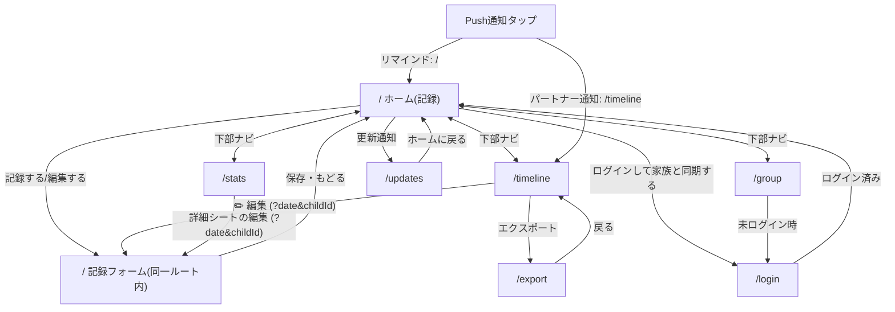

# あさノート 仕様書

子どもが登校を渋る朝のようすを、選ぶだけでサッと記録する家族向けPWA。
本書は実装（`src/`・`supabase/`・`public/sw.js`・`e2e/`・`.github/workflows/`）から起こした現状の仕様書で、**食い違いがあれば実装が正**。
対象バージョン: v0.4.2（`src/data/releases.ts` 先頭）。

## 本書の使い方・メンテナンス方針

- 実装箇所は `path/to/file.ts` で示す（行番号は書かない）。
- コードから意図が確証できない点は **要確認 Qn** と明記し、付録A に一覧する。解消したら本文へ反映して付録から消す。
- 「〜のため（推定）」は、コードやコメントに根拠が無く、書き手が理由を補った箇所。

### 更新ルール

CIが強制するもの（`.github/workflows/ci.yml` の `release-notes-check`、判定は `scripts/check-release-notes.mjs`）:

| 条件 | 結果 |
|---|---|
| `src/app/` `src/components/` `src/lib/` `src/constants/` `public/` に、テスト（`*.test.ts(x)`）・生成型（`database.types.ts`）以外の変更がある | `src/data/releases.ts` の更新が必須。先頭 version が変更前より新しくなければ失敗 |
| `releases.ts` 先頭・`package.json`・`package-lock.json` の version が不一致 | 常に失敗（例外指定でも確認される） |
| PRに `no-release-note` ラベル、またはPR本文・タイトル・コミットメッセージに `[skip release-note]` | 更新履歴の追加チェックのみ省略（依存更新・内部リファクタ等） |

CIが強制しないもの（レビューで担保する）:

- **本書の更新はCIの対象外**。挙動・スキーマ・運用手順を変えるPRは、同じPRで本書も更新する。ユーザー向けの変更なら `releases.ts` と version（`package.json` / `package-lock.json`）も同じPRで更新する。
- `docs/`・`README.md`・`supabase/`・`scripts/`・`e2e/` のみの変更は `release-notes-check` の対象外（更新履歴は不要）。
- `supabase/schema.sql` を変えたら `npm run db:types` で `src/lib/db/database.types.ts` を再生成する（`db-types-check` が差分を検出して失敗させる）。`main` マージ時に本番へ自動適用される（§8）。
- Push通知まわりのSQL・Edge Functionは自動適用されない（§8、`docs/push-notifications-setup.md`）。

## 1. プロダクト概要

### 1.1 何を解決するか

子どもの登校渋りは、朝のごく短い時間に起き、親は振り返る余裕がない。後から「いつ・どんな朝に渋ったか」を思い出せず、学校や専門家に状況を説明しづらい。
あさノートは、その朝のようすを**選ぶだけ**で記録し、積み重ねから傾向（良かった理由・気になる理由）を見返せるようにする。

### 1.2 対象ユーザー

| 区分 | 内容 |
|---|---|
| 主な利用者 | 登校渋りの子どもを持つ保護者。夫婦・家族で1つのグループを作って共有する想定（README「家族向け」） |
| 間接的な受け手 | 学校の先生・スクールカウンセラー等。エクスポート（印刷/PDF/CSV）を受け取る（`src/app/export/page.tsx` の説明文） |
| 利用形態 | スマートフォンのホーム画面に追加したPWA（縦向き。`public/manifest.webmanifest`）。ブラウザでも使える |

利用範囲（家族内の限定運用か、一般公開か）はコードから確証が取れない。**要確認 Q13**

### 1.3 設計原則

| 原則 | 具体化 | 主な実装 |
|---|---|---|
| 入力の手間を最小化する | 結果・起床・出発・理由はタップで選ぶ。時刻は3区分。記録は1画面で完結。メモは任意 | `src/app/_home/` |
| オフラインファースト | 保存はまず端末のIndexedDBへ。通信が無くても記録自体は失敗しない。未ログインでも使える | `src/lib/db/records.ts` `localDb.ts` |
| 入力を失わない | 入力途中は下書きとして自動保存し、他画面へ行っても復元する | `src/app/_home/draftStorage.ts` |
| 責めず、どちらも見返す | 「いい日も気になる日も、どちらも振り返れる」（傾向画面の文言）。理由は前向き/気になるの両方を持つ | `src/app/stats/page.tsx` |
| 家族で共有し、誤操作で壊さない | グループ内で記録を共有するが、編集・削除は記録者本人のみ | `src/lib/db/ownership.ts`・RLS（§6） |
| 個人情報を必要最小限にする | エクスポートにメールアドレスを出さない。計測は内容（メモ・タグ文言）を送らない | §6.5, §11 |

### 1.4 ユーザーストーリー

| ID | ストーリー | 章 |
|---|---|---|
| U1 | 保護者として、忙しい朝でも数タップで結果を残したい | §3.1 |
| U2 | 保護者として、夜や後日に、朝の記録を追加・修正したい（過去日も選べる） | §3.1 |
| U3 | 保護者として、電波が悪くても記録が消えないでほしい | §7 |
| U4 | 保護者として、パートナーがもう記録したか、すぐ知りたい | §3.1, §4 |
| U5 | 保護者として、未記録の日は夜に思い出させてほしい | §4 |
| U6 | 保護者として、曜日・起床時刻・理由ごとの傾向を見て対策を考えたい | §3.3 |
| U7 | 保護者として、一定期間の記録を学校やカウンセラーへ渡したい | §3.4 |
| U8 | 保護者として、夫婦で同じ記録を見たい。ただし相手の記録を誤って消したくない | §3.5, §6 |
| U9 | 複数の子どもがいる保護者として、子どもごとに記録・集計を分けたい | §3.1, §3.5 |
| U10 | ログインが面倒な人として、まず登録なしで試したい | §3.6 |

## 2. 画面一覧と遷移

### 2.1 ルート一覧

| ルート | 画面 | 目的 | 主な操作 | 主な遷移先 |
|---|---|---|---|---|
| `/` | ホーム（記録） | 日付を選び、その日の結果・理由等を記録する | 日付選択、子ども切替、記録開始/編集、保存 | `/updates`（更新通知）、`/login`（ヘッダー） |
| `/timeline` | これまでの記録 | 自分＋パートナーの記録を新しい順に見る | 子ども・結果での絞り込み、編集、削除 | `/?date=…`（編集）、`/export` |
| `/stats` | 傾向 | 内訳・カレンダー・曜日別/起床時刻別スムーズ率・理由を見る | 子ども切替、各項目タップで詳細シート | `/?date=…`（詳細シートから編集） |
| `/export` | エクスポート | 期間を指定して日記形式で印刷/PDF、またはCSV出力する | 期間・パートナー含有の指定、印刷、CSV | `/timeline` |
| `/group` | 共有 | 子ども・通知・グループの設定 | 子どもの追加/改名/削除、通知設定、グループ作成/参加/脱退、招待 | `/login`（未ログイン時） |
| `/login` | ログイン | メールのマジックリンクでログインする | メール入力→送信 | ログイン済みなら `/` へ置換 |
| `/updates` | 更新履歴 | 全バージョンの更新内容を見る（開くと最新版を既読にする） | 閲覧 | `/` |
| （404） | `not-found.tsx` | 存在しないURL | — | `/` |
| （エラー） | `error.tsx` / `global-error.tsx` | 想定外エラーのフォールバック。「やり直す」で再描画（Next 16 の prop 名は `retry`） | やり直す | — |

共通要素:

- **下部ナビ**（`src/components/BottomNav.tsx`）: 記録する(`/`)・これまで(`/timeline`)・傾向(`/stats`)・共有(`/group`)の4タブ。現在地は完全一致で判定するため、`/export` `/login` `/updates` ではどのタブも選択状態にならない。入力途中の下書きがあると「記録する」にドットのバッジを出す。印刷時は非表示。
- **同期失敗の通知**（`SyncFailureNotice`）: 同期が連続失敗したときだけ画面下部に出す（§7.6）。
- **ログイン状態表示**（`AuthStatus`）: ホーム画面のヘッダーにのみ表示される（ログインへのリンク／メールアドレス・未同期件数・ログアウト）。他の画面にはログアウト導線が無い。
- **読み込み中**（`loading.tsx`）: ルート遷移中のスケルトン。

### 2.2 遷移図

`/` 内の「ホーム」と「記録フォーム」は同一ルートの2状態（`Step = "home" | "form"`、`src/app/_home/types.ts`）。フォームへ進むと `history.pushState` で履歴を1つ積み、ブラウザ/端末の戻るボタンで home へ戻れる（`useStepNavigation.ts`）。

