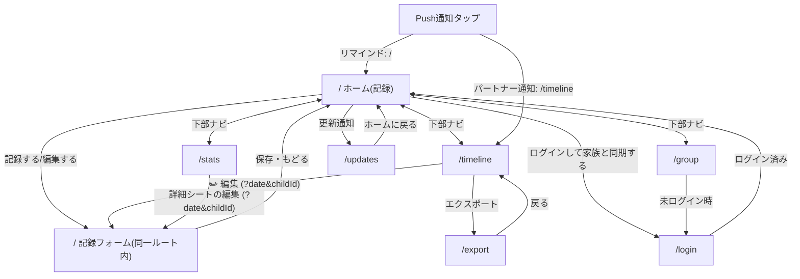

# あさノート 仕様書

子どもが登校を渋る朝のようすを、選ぶだけでサッと記録する家族向けPWA。
本書は実装（`src/`・`supabase/`・`public/sw.js`・`e2e/`・`.github/workflows/`）から起こした現状の仕様書で、**食い違いがあれば実装が正**。
対象バージョン: v0.4.2（`src/data/releases.ts` 先頭）。

## 本書の使い方・メンテナンス方針

- 実装箇所は `path/to/file.ts` で示す（行番号は書かない）。
- コードから意図が確証できない点は **要確認 Qn** と明記し、付録A に一覧する。解消したら本文へ反映して付録から消す。
- 「〜のため（推定）」は、コードやコメントに根拠が無く、書き手が理由を補った箇所。

### 更新ルール

CIが強制するもの（`.github/workflows/ci.yml` の `release-notes-check`、判定は `scripts/check-release-notes.mjs`）:

| 条件 | 結果 |
|---|---|
| `src/app/` `src/components/` `src/lib/` `src/constants/` `public/` に、テスト（`*.test.ts(x)`）・生成型（`database.types.ts`）以外の変更がある | `src/data/releases.ts` の更新が必須。先頭 version が変更前より新しくなければ失敗 |
| `releases.ts` 先頭・`package.json`・`package-lock.json` の version が不一致 | 常に失敗（例外指定でも確認される） |
| PRに `no-release-note` ラベル、またはPR本文・タイトル・コミットメッセージに `[skip release-note]` | 更新履歴の追加チェックのみ省略（依存更新・内部リファクタ等） |

CIが強制しないもの（レビューで担保する）:

- **本書の更新はCIの対象外**。挙動・スキーマ・運用手順を変えるPRは、同じPRで本書も更新する。ユーザー向けの変更なら `releases.ts` と version（`package.json` / `package-lock.json`）も同じPRで更新する。
- `docs/`・`README.md`・`supabase/`・`scripts/`・`e2e/` のみの変更は `release-notes-check` の対象外（更新履歴は不要）。
- `supabase/schema.sql` を変えたら `npm run db:types` で `src/lib/db/database.types.ts` を再生成する（`db-types-check` が差分を検出して失敗させる）。`main` マージ時に本番へ自動適用される（§8）。
- Push通知まわりのSQL・Edge Functionは自動適用されない（§8、`docs/push-notifications-setup.md`）。

## 1. プロダクト概要

### 1.1 何を解決するか

子どもの登校渋りは、朝のごく短い時間に起き、親は振り返る余裕がない。後から「いつ・どんな朝に渋ったか」を思い出せず、学校や専門家に状況を説明しづらい。
あさノートは、その朝のようすを**選ぶだけ**で記録し、積み重ねから傾向（良かった理由・気になる理由）を見返せるようにする。

### 1.2 対象ユーザー

| 区分 | 内容 |
|---|---|
| 主な利用者 | 登校渋りの子どもを持つ保護者。夫婦・家族で1つのグループを作って共有する想定（README「家族向け」） |
| 間接的な受け手 | 学校の先生・スクールカウンセラー等。エクスポート（印刷/PDF/CSV）を受け取る（`src/app/export/page.tsx` の説明文） |
| 利用形態 | スマートフォンのホーム画面に追加したPWA（縦向き。`public/manifest.webmanifest`）。ブラウザでも使える |

利用範囲（家族内の限定運用か、一般公開か）はコードから確証が取れない。**要確認 Q13**

### 1.3 設計原則

| 原則 | 具体化 | 主な実装 |
|---|---|---|
| 入力の手間を最小化する | 結果・起床・出発・理由はタップで選ぶ。時刻は3区分。記録は1画面で完結。メモは任意 | `src/app/_home/` |
| オフラインファースト | 保存はまず端末のIndexedDBへ。通信が無くても記録自体は失敗しない。未ログインでも使える | `src/lib/db/records.ts` `localDb.ts` |
| 入力を失わない | 入力途中は下書きとして自動保存し、他画面へ行っても復元する | `src/app/_home/draftStorage.ts` |
| 責めず、どちらも見返す | 「いい日も気になる日も、どちらも振り返れる」（傾向画面の文言）。理由は前向き/気になるの両方を持つ | `src/app/stats/page.tsx` |
| 家族で共有し、誤操作で壊さない | グループ内で記録を共有するが、編集・削除は記録者本人のみ | `src/lib/db/ownership.ts`・RLS（§6） |
| 個人情報を必要最小限にする | エクスポートにメールアドレスを出さない。計測は内容（メモ・タグ文言）を送らない | §6.5, §11 |

### 1.4 ユーザーストーリー

| ID | ストーリー | 章 |
|---|---|---|
| U1 | 保護者として、忙しい朝でも数タップで結果を残したい | §3.1 |
| U2 | 保護者として、夜や後日に、朝の記録を追加・修正したい（過去日も選べる） | §3.1 |
| U3 | 保護者として、電波が悪くても記録が消えないでほしい | §7 |
| U4 | 保護者として、パートナーがもう記録したか、すぐ知りたい | §3.1, §4 |
| U5 | 保護者として、未記録の日は夜に思い出させてほしい | §4 |
| U6 | 保護者として、曜日・起床時刻・理由ごとの傾向を見て対策を考えたい | §3.3 |
| U7 | 保護者として、一定期間の記録を学校やカウンセラーへ渡したい | §3.4 |
| U8 | 保護者として、夫婦で同じ記録を見たい。ただし相手の記録を誤って消したくない | §3.5, §6 |
| U9 | 複数の子どもがいる保護者として、子どもごとに記録・集計を分けたい | §3.1, §3.5 |
| U10 | ログインが面倒な人として、まず登録なしで試したい | §3.6 |

## 2. 画面一覧と遷移

### 2.1 ルート一覧

| ルート | 画面 | 目的 | 主な操作 | 主な遷移先 |
|---|---|---|---|---|
| `/` | ホーム（記録） | 日付を選び、その日の結果・理由等を記録する | 日付選択、子ども切替、記録開始/編集、保存 | `/updates`（更新通知）、`/login`（ヘッダー） |
| `/timeline` | これまでの記録 | 自分＋パートナーの記録を新しい順に見る | 子ども・結果での絞り込み、編集、削除 | `/?date=…`（編集）、`/export` |
| `/stats` | 傾向 | 内訳・カレンダー・曜日別/起床時刻別スムーズ率・理由を見る | 子ども切替、各項目タップで詳細シート | `/?date=…`（詳細シートから編集） |
| `/export` | エクスポート | 期間を指定して日記形式で印刷/PDF、またはCSV出力する | 期間・パートナー含有の指定、印刷、CSV | `/timeline` |
| `/group` | 共有 | 子ども・通知・グループの設定 | 子どもの追加/改名/削除、通知設定、グループ作成/参加/脱退、招待 | `/login`（未ログイン時） |
| `/login` | ログイン | メールのマジックリンクでログインする | メール入力→送信 | ログイン済みなら `/` へ置換 |
| `/updates` | 更新履歴 | 全バージョンの更新内容を見る（開くと最新版を既読にする） | 閲覧 | `/` |
| （404） | `not-found.tsx` | 存在しないURL | — | `/` |
| （エラー） | `error.tsx` / `global-error.tsx` | 想定外エラーのフォールバック。「やり直す」で再描画（Next 16 の prop 名は `retry`） | やり直す | — |

共通要素:

- **下部ナビ**（`src/components/BottomNav.tsx`）: 記録する(`/`)・これまで(`/timeline`)・傾向(`/stats`)・共有(`/group`)の4タブ。現在地は完全一致で判定するため、`/export` `/login` `/updates` ではどのタブも選択状態にならない。入力途中の下書きがあると「記録する」にドットのバッジを出す。印刷時は非表示。
- **同期失敗の通知**（`SyncFailureNotice`）: 同期が連続失敗したときだけ画面下部に出す（§7.6）。
- **ログイン状態表示**（`AuthStatus`）: ホーム画面のヘッダーにのみ表示される（ログインへのリンク／メールアドレス・未同期件数・ログアウト）。他の画面にはログアウト導線が無い。
- **読み込み中**（`loading.tsx`）: ルート遷移中のスケルトン。

### 2.2 遷移図

`/` 内の「ホーム」と「記録フォーム」は同一ルートの2状態（`Step = "home" | "form"`、`src/app/_home/types.ts`）。フォームへ進むと `history.pushState` で履歴を1つ積み、ブラウザ/端末の戻るボタンで home へ戻れる（`useStepNavigation.ts`）。

## 3. 機能仕様

### 3.1 記録する（ホーム `/`）

#### 3.1.1 ホーム状態（日付を選ぶ）

上から順に表示する（`src/app/page.tsx`）:

1. ヘッダー: 「{M月D日(曜)}のきろく」とログイン状態表示。
2. 更新通知（§3.7）。
3. パートナーの完了バッジ: グループに2人以上いて、**今日**の、**選択中の子ども**（子ども1人以下なら未分類）のパートナーの記録に結果が入っていれば「💐 今日の記録は完了しています」を出す（`PartnerRecordStatus`）。未完了のときは何も出さない。
4. 子ども切替: 子どもが2人以上のときだけ表示（「すべて」は無い。記録は必ず特定の子に紐づくため）。
5. 月カレンダー（`MonthCalendar`）。
6. アプリ内リマインド（§4.1）。
7. 記録ボタン、または記録済みの要約カード。

月カレンダー:

- ◀▶で月を移動できる（選択日は変わらない）。表示月が今月でなければ「今日」ボタンで今日へ戻る。
- 日付セルをタップすると選択（accent色で塗りつぶし）。**未来日も選べて記録できる**（制限なし。意図は **要確認 Q19**）。
- 記録のある日は結果ごとの淡色とドットで示す（スムーズ=accent / 行き渋り=amber / 行かなかった=calm）。パートナーの記録も含め、同じ日に複数あれば更新が新しい方を使う。子どもは選択中の子に一致する記録のみ（`useRecordStatusForMonth`）。
- 日曜と祝日は赤、土曜は青で日付・曜日見出しを表示する（選択中のセルは塗りつぶし色を優先し、色分けしない）。祝日は `@holiday-jp/holiday_jp` の同梱データで判定する（通信不要。`src/lib/holidays.ts`）。祝日名はセルの `title` / `aria-label` に入る。

記録ボタン（選択日に**自分の**記録があり結果が入っていれば要約カード、無ければ開始ボタン）:

- 開始ボタン: 「📝 今日の様子を記録する」（過去日・未来日は「この日の様子を記録する」）。
- 要約カード: 結果の絵文字とラベル、理由（「・」区切り、1行に切り詰め）、「✏️ 記録を編集する」。パートナーの記録はここには出ない（カレンダーの色と完了バッジにのみ反映）。
- ボタン上で左右にスワイプ（50px以上かつ横方向優位）すると日付が前後に動く。左→翌日、右→前日。スワイプ直後の合成クリックでボタンが誤作動しないよう一度だけ抑止する。
- 読み込み中（その日の記録をIndexedDBから取得するまで）はスケルトンを出す。

#### 3.1.2 フォーム状態（入力する）

「記録する」「編集する」で同一ルート内のフォームへ進む。1画面で最後まで入力できる（画面遷移なし）。ヘッダーの「← もどる」（ブラウザの戻る、端末の戻るも同じ）でホームへ戻る。**戻ると入力途中の内容は下書きごと破棄される**（§3.1.4）。

| 順 | 項目 | 入力 | 必須 | 保存先（`records`） |
|---|---|---|---|---|
| 1 | 今日はどうだった？（過去日は「この日は」） | 3択: 😊 スムーズ / 😣 行き渋った / 🏠 行かなかった。選択中はリング＋✓ | **必須** | `outcome`（`smooth` / `reluctant` / `absent`） |
| 2 | ⏰ 朝起きた時間は？ | 3区分から1つ: 7時より前 / 7時〜7時15分 / 7時15分〜。もう一度押すと解除 | 任意 | `wake_time`（代表値 `06:59` / `07:08` / `07:15`） |
| 3 | 🕗 出発した時刻は？ | 3区分から1つ: 8時より前 / 8時過ぎ / 8時半以降。もう一度押すと解除 | 任意 | `depart_time`（代表値 `07:59` / `08:15` / `08:30`） |
| 4 | 😊 よかった理由は？ / 😣 気になる理由は？ | タグを複数選択、「＋追加」で自由入力のタグを追加。**結果を選ぶまで表示しない** | 任意 | `reason_tags` |
| 5 | 📝 メモ欄 | 自由記述（最大2000文字。残り文字数表示） | 任意 | `memo` |
| 6 | 記録プレビュー | 入力から自動生成した日記文（表示のみ） | — | 保存しない |

- 区分の定義は `src/lib/wakeTime.ts` / `src/lib/departTime.ts`。保存は代表値、表示は時刻から区分へ引き直す。旧データや他端末の任意の時刻も同じ境界で区分に寄る。
- 理由の候補: 結果が「スムーズ」なら前向きな理由、それ以外なら気になる理由（初期セットは `src/constants/choices.ts`）。**自分の過去の記録（その子どもの分）での使用回数が多い順**に並べ、同数は初期セットの定義順。「＋追加」のタグは、そのタグを使った記録が残る限り翌日以降も候補に出る（使った記録が無くなれば消える）。初期セットは使用0回でも常に出す（`src/lib/reasonOptions.ts`）。
- 結果を「スムーズ」と「それ以外」の間で切り替えると、選択済みの理由はクリアされる（候補が別の集合のため）。「行き渋った」↔「行かなかった」の切替では保持する。
- 日記文は「{結果ラベル}。理由は「A・B」。{出発区分}に出発。{メモ}。」の形（`src/lib/recordPreview.ts`）。起床時刻は含まない。エクスポートでも同じ関数を使う。
- 保存ボタン「✓ この日の記録を保存する」は、結果が未選択、または読み込み中は無効。無効の間は「「今日はどうだった？」を選ぶと保存できます」と案内する。

#### 3.1.3 保存

1. メモを2000文字に切り詰め、IndexedDBへ即時書き込み（`syncStatus: "pending"`）。同じIDなら上書きで、`createdAt` は初回の値を保つ。
2. バックグラウンドでSupabaseへの同期を試みる（§7）。
3. 「💐 保存しました」を約1.8秒表示し、ホームへ戻る（下書きはホーム到達時に消える）。

保存時、旧フォーム由来のフィールド（起床タグ・きっかけ・対応タグ・同行者・引き渡し先）と体調（`conditionScale`）は、既存記録が持っていればそのまま書き戻す（消さない）。新規記録では空/nullになる。

#### 3.1.4 下書き

- フォーム状態の間、入力内容を `localStorage`（キー `asa-note:draft`）へ保存し続ける。1枠のみ。ホーム状態になる（保存・戻る・下部ナビのリセット）と削除する。
- 再訪時、**下書きの日付と選択日が一致する場合のみ**、IndexedDBの内容より優先して復元し、フォーム状態へ直接進む（履歴も1つ積む）。
- 入力途中の記録があると、下部ナビ「記録する」にバッジを出す（別タブでの変更も購読する）。
- フォーム状態で下部ナビの「記録する」を押すとホーム状態へ戻る（既にホームルートにいるため、`window` イベントで伝える。`src/lib/recordFlowReset.ts`）。
- 旧版（フローが3画面だった頃）の下書きは、ホーム以外のステップをすべてフォームとして読み込む。

#### 3.1.5 他画面からの編集リンク

`/?date=YYYY-MM-DD[&childId=…]` で開くと、その日付（と子ども）を選択し、**常にフォーム状態**で開く（既存記録があれば内容を読み込む。無ければ空フォーム）。`childId` は端末の「選択中の子ども」にも反映する。タイムライン・傾向の詳細シートの編集導線がこれを使う。

#### 3.1.6 業務ルール

| ルール | 理由 |
|---|---|
| 記録は「記録者×日付×子ども」で1件。同じ日に再度記録すると既存を編集する（`findLatestOwnRecordForDate`）。**一意制約はアプリ側のみ**（DBに無い。§5.4, §7.5） | 朝の記録を1件で完結させ、見返す単位を日にそろえる（推定） |
| 結果が必須。理由欄は結果の後に出す | 結果によって理由の候補が変わるため（`RecordFormView` のコメント） |
| 起床・出発は3区分 | 朝の忙しい時間に分単位の入力を求めない。分単位の精度は振り返りに使っていないため |
| 理由は使用頻度順 | よく使う理由をすぐ選べるように（v0.3.0） |
| メモは2000文字まで | DBの `CHECK` 制約と同じ値。超えると同期が永久に失敗するため（#57） |
| 子どもが0〜1人の家庭では記録を常に「未分類」（`childId: null`）で保存する | 入力を増やさないため（`resolveEffectiveChildId`） |
| 保存はローカル先行 | オフラインでも記録を必ず成功させるため |
| 下書きを残す | 他の画面を見に行っても入力途中を失わないため |
| 自分の記録だけが要約・編集の対象 | パートナーの記録を誤って上書きしないため（§6） |

#### 3.1.7 エラー時の挙動

- 同期の失敗は保存を妨げない。連続失敗時のみ通知する（§7.6）。
- 子ども一覧の取得に失敗（オフライン含む）すると「子どもなし」と同じ扱いになり、記録は `childId: null` で保存される。**要確認 Q8**
- IndexedDBへの書き込み失敗を扱う専用のUIは無い（`handleSave` に `try/catch` が無い）。
- ブラウザの `localStorage` が使えない環境（プライベートブラウズ等）では、下書き・選択中の子ども等の保存を黙ってあきらめ、入力自体は続けられる（`src/lib/localStorageStore.ts`）。

